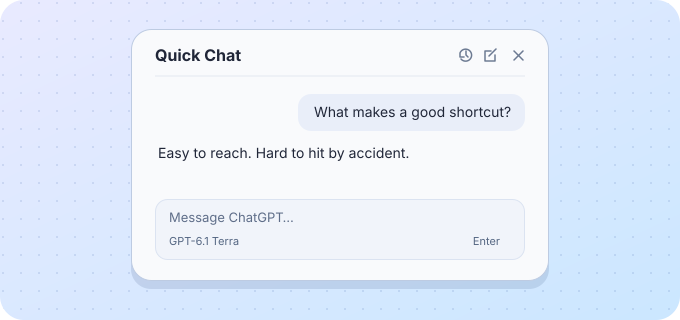

# Quick Chat

**ChatGPT one shortcut away on macOS.**



- Open a fresh chat from any app with your own keyboard shortcut.
- Stream Markdown replies with syntax highlighting. Switch chats without interrupting a reply.
- Pick GPT-6 Luna or GPT-6.1 Terra and a reasoning level in the popup. Find past chats in local history.

## Get started

Requires **macOS 14 or later**, **Xcode 16 or later** to build, and an eligible **ChatGPT plan**. No API key is needed.

```sh
git clone https://github.com/lexlexlexdev/quick-chat.git
cd quick-chat
./build.sh
open 'build/Quick Chat.app'
```

1. Open Quick Chat from the menu bar and connect ChatGPT in **Settings**.
2. Choose **Keyboard Shortcut…** from the menu bar menu to record your shortcut. No shortcut is assigned by default.
3. Press <kbd>Enter</kbd> to send or <kbd>Shift</kbd> + <kbd>Enter</kbd> for a new line.

Chat history and drafts stay on your Mac in SQLite. Sign-in credentials are stored in Keychain. Messages you send are processed by ChatGPT.

[Changelog](CHANGELOG.md) · [Third-party notices](Sources/QuickChat/TranscriptAssets/THIRD_PARTY_NOTICES.txt)
